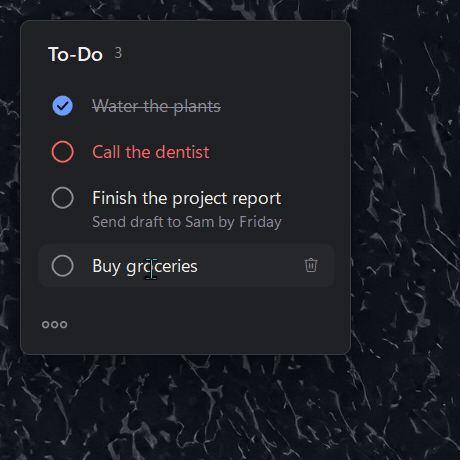

# Sticky Todo

A minimalist to-do sticky note for Windows 10/11 that can stay always on top.



## Install

1. Open the [latest release](../../releases/latest) and download **StickyTodo-Setup.exe**.
2. Run it. It installs for your user only (no admin prompt) and adds a Start menu entry.
3. If Windows shows "Windows protected your PC", click **More info → Run anyway**. The app isn't code-signed.

Your to-dos are stored in `%APPDATA%\StickyTodo`. Uninstall from **Settings → Apps**.

## Build from source

Requires only the .NET Framework 4.8 compiler that ships with Windows.

```
build.cmd                  # builds StickyTodo.exe
ISCC.exe StickyTodo.iss    # builds dist\StickyTodo-Setup.exe (needs Inno Setup 6)
```

## Releasing

Push a version tag and GitHub Actions builds the installer and publishes the release:

```
git tag v1.2.0
git push origin v1.2.0
```
